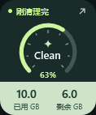
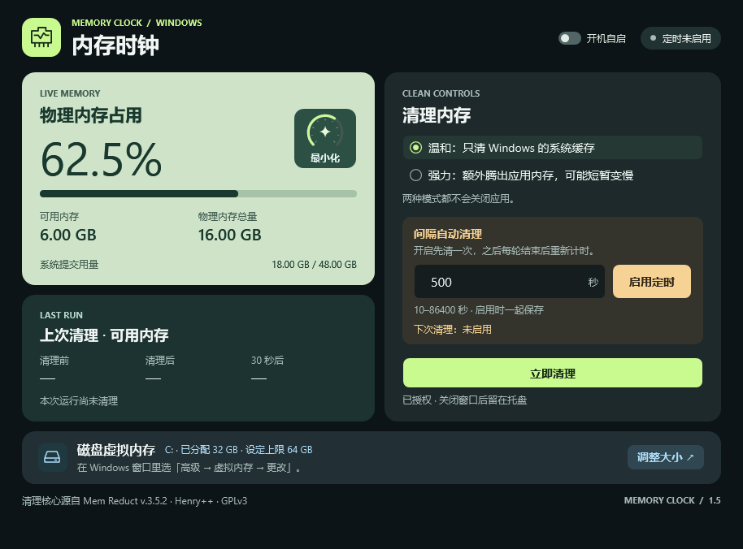

# 内存时钟 · Memory Clock

一只放在 Windows 桌面角落的内存表。弧线显示已用内存，下面是已用和剩余容量；点中央的 **Clean** 就能清理。

**感谢原作者 [Henry++](https://github.com/henrypp)。** 清理核心移植自 [Mem Reduct v.3.5.2](https://github.com/henrypp/memreduct/tree/2f5c55d15f69a2c88859e036b16c6f4c971e1968)，Copyright © 2011–2025 Henry++。内存时钟是独立改版，不是 Mem Reduct 官方版本。原版权声明保留在清理源码中，本项目按 [GNU GPLv3](LICENSE) 分发。

[下载 Windows x64 便携版](https://github.com/M47E1/memory-clock/releases/download/v1.5.0/MemoryClock-portable.zip) · [使用说明](memory-clock/README.md)

解压到一个固定文件夹后，运行 `MemoryClock.exe`。适用于 Windows 10/11 x64，需要 .NET Framework 4.8。查看用量和设置自启不需要管理员权限，首次清理时 Windows 会询问授权。

<p></p>

- **清理模式：** 温和只清 Windows 系统缓存；强力还会腾出应用占用的内存，切回应用时可能短暂变慢。
- **间隔清理：** 填好秒数并点「启用定时」，立即清理一次，此后每轮结束再开始倒计时。
- **开机自启：** 右上角开关默认关闭。打开后，下次登录会启动到托盘。自启和定时分开，不会在登录时主动清理。
- **磁盘虚拟内存：** 查看分页文件容量，或打开 Windows 设置，自行选择 SSD 和容量。



## 从源码构建

在 Windows PowerShell 中，从仓库根目录运行：

```powershell
powershell.exe -NoProfile -File .\memory-clock\Build.ps1 -Verify
```

生成的程序和附带完整对应源码的便携包都在 `bin\memory-clock`。验证使用模拟清理和临时注册表项，不改真实启动项。[修改说明](memory-clock/README.md#源码与许可) 和 [上游源码](engines/MemReduct/source-v.3.5.2.zip) 随项目保留。
